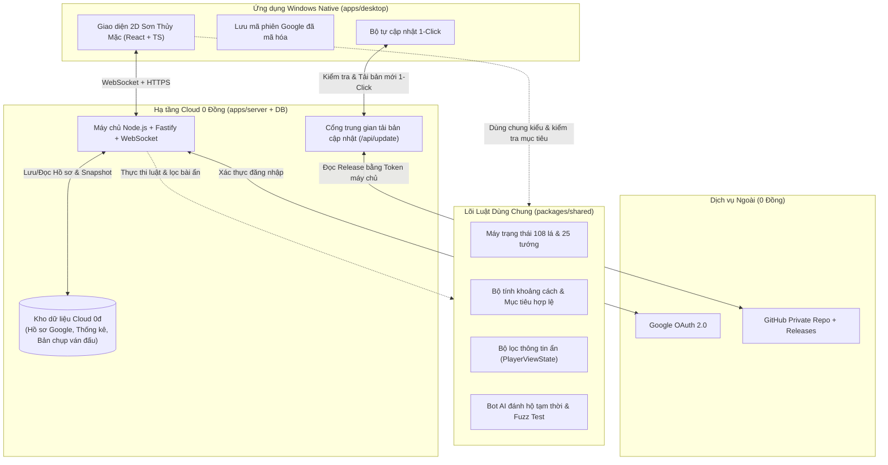

# ARCHITECTURE.md — Cấu Trúc Hệ Thống và Quyết Định Kỹ Thuật

> **Dự án:** LKDF — Game Thẻ Bài Tam Quốc Sát (Windows Native Online 4–8 Người)
> **Cập nhật lần cuối:** 2026-11-16
> **Tài liệu liên quan:** [REQUIREMENTS.md](./REQUIREMENTS.md) · [DATA_MODEL.md](./DATA_MODEL.md) · [DEPLOYMENT.md](./DEPLOYMENT.md) · [DECISIONS.md](./DECISIONS.md)

---

## 1. Tổng Quan Kiến Trúc Hệ Thống

Hệ thống được thiết kế theo mô hình **Monorepo 3 thành phần** kết hợp **Máy chủ quyết định trạng thái (Server-Authoritative)** và **Lưu trữ bền vững trên Cloud 0 đồng**, đảm bảo 3 mục tiêu cốt lõi: **0 lệch luật giữa máy chủ và máy khách**, **0 treo bàn khi rớt mạng hoặc máy chủ nghỉ**, và **cập nhật bản mới bằng 1 cú nhấp chuột từ kho GitHub Private**.



---

## 2. Cấu Trúc Thư Mục Dự Án (Monorepo)

```text
c:\Tam quốc sát\
├── packages/
│   └── shared/                 # Lõi luật thuần TypeScript (Không phụ thuộc mạng hay giao diện)
│       ├── src/
│       │   ├── cards/          # Định nghĩa & quy tắc 108 lá bài (gồm 4 lá EX)
│       │   ├── heroes/         # Định nghĩa & kỹ năng 25 Tướng Bản Tiêu Chuẩn gốc
│       │   ├── engine/         # Máy trạng thái (StateMachine), Ngăn xếp phản ứng (InterruptStack)
│       │   ├── distance/       # Tính khoảng cách ngựa +1/-1, tầm vũ khí, mục tiêu hợp lệ
│       │   ├── projection/     # Hàm lọc MasterGameState -> PlayerViewState (giấu bài úp/thân phận)
│       │   ├── bot/            # Logic Máy đánh hộ tạm thời khi rớt mạng & chạy Fuzz Test
│       │   └── types/          # Toàn bộ hợp đồng dữ liệu dùng chung Client - Server
│       └── tests/              # Unit test 25 tướng/108 lá & Fuzz test >=100 ván mỗi mốc 4–8 người
├── apps/
│   ├── server/                 # Máy chủ phòng chơi Online (Node.js + Fastify + ws)
│   │   └── src/
│   │       ├── auth/           # Xử lý Google OAuth 2.0 + cấp phát/kiểm tra phiên đăng nhập
│   │       ├── rooms/          # Quản lý phòng 4–8 người thật, đồng hồ pha, Acting Host 30s
│   │       ├── persistence/    # Lưu/khôi phục RoomSnapshot & Thống kê người dùng trên Cloud 0đ
│   │       └── update-proxy/   # Trung gian kiểm tra & tải bản cài từ GitHub Private Releases
│   └── desktop/                # Ứng dụng Windows Native (Tauri v2 hoặc Electron dự phòng)
│       ├── src/                # Giao diện React + TypeScript + Tailwind CSS (100vh không cuộn)
│       └── src-tauri/          # Cấu hình cửa sổ Windows, nháy Taskbar, chống tắt nhầm, Updater
└── docs/
    └── intent/                 # Tài liệu chốt ý định gốc
```

### Lựa chọn công nghệ đóng gói Windows Native (`apps/desktop`)
- **Phương án ưu tiên số 1:** **Tauri v2** (sử dụng nhân hiển thị WebView2 có sẵn trên Windows 10/11, bộ cài `.exe`/`.msi` nhẹ ~5–10MB, tích hợp sẵn `tauri-plugin-updater` và API nháy thanh Taskbar).
- **Phương án dự phòng tương thích 100%:** **Electron + electron-updater** (nếu máy lập trình chưa cài trình biên dịch Rust/C++ ở Giai đoạn 0). Vì toàn bộ giao diện viết bằng React + TypeScript và dùng chung `packages/shared`, việc dùng Tauri hay Electron đều giữ nguyên 100% tính năng, giao diện và cơ chế cập nhật 1-click.

---

## 3. Thiết Kế Giải Pháp Cho 5 Bài Toán Kỹ Thuật Cốt Lõi

### 3.1. Đăng nhập Google OAuth 2.0 mượt mà trên Ứng dụng Windows + Cloud 0 đồng
Để tránh lỗi trình duyệt bị chặn khi gọi ngược về ứng dụng `.exe` và tránh lỗi máy chủ Cloud 0 đồng đang ngủ:
1. **Bước đánh thức trước:** Nếu người chơi chưa có phiên đăng nhập lưu trên máy, ứng dụng gọi `/api/health` để đánh thức máy chủ Cloud 0 đồng dậy hoàn toàn trước khi mở trình duyệt.
2. **Bước tạo phiên chờ đăng nhập (`authSessionId`):** Ứng dụng tạo một mã phiên chờ ngắn hạn (`2 phút`), mở trình duyệt mặc định tới trang xác nhận Google OAuth 2.0 của máy chủ, đồng thời lắng nghe kết quả qua kết nối trực tiếp (kèm cổng cục bộ `127.0.0.1` trên máy).
3. **Bước nhận kết quả tự động + Dự phòng 1 chạm:**
   - Ngay khi người chơi bấm xác nhận tài khoản Google trên trình duyệt, máy chủ xác thực với Google, lưu hồ sơ `UserProfile` (theo mã `googleSub` cố định) và đẩy ngay mã phiên đăng nhập (`accessToken` + `refreshToken`) về ứng dụng Windows đang mở → **Ứng dụng tự động vào thẳng Sảnh chính trong 1 giây**.
   - Trên trang trình duyệt vừa xác nhận cũng có sẵn nút **`[📋 Sao chép mã đăng nhập]`** dự phòng trong trường hợp máy người dùng bật tường lửa chặn kết nối cục bộ.
4. **Tự động ghi nhớ:** Mã phiên được lưu an toàn trên máy Windows; các lần mở ứng dụng sau tự động đăng nhập thẳng mà không cần mở lại trình duyệt.

### 3.2. Cập nhật 1 cú nhấp chuột (1-Click In-App Update) từ Kho GitHub Private
Vì kho GitHub (`Play-with-me/LKDF`) ở chế độ **Private** và người chơi không đăng nhập GitHub:
1. Mỗi khi đẩy bản phát hành mới (ví dụ tag `v1.0.2`) lên GitHub, **GitHub Actions** tự động biên dịch bộ cài Windows, ký số bằng khóa nội bộ của dự án (`TAURI_SIGNING_PRIVATE_KEY`) và đăng lên **GitHub Releases** của kho Private.
2. Trên **Máy chủ Cloud 0 đồng (`apps/server`)**, cấu hình duy nhất 1 biến môi trường bảo mật `GITHUB_RELEASE_TOKEN` (chỉ có quyền đọc Releases của kho `LKDF`).
3. Máy chủ cung cấp 2 đường dẫn công khai cho ứng dụng Windows:
   - `GET /api/update/latest`: Trả về số phiên bản mới nhất, ghi chú thay đổi, chữ ký xác thực và đường dẫn tải.
   - `GET /api/update/download/:asset`: Truyền trực tiếp gói cập nhật từ GitHub Private về ứng dụng.
4. Khi người chơi mở app (hoặc vào phòng), nếu phiên bản hiện tại thấp hơn bản mới nhất, hộp thoại thông báo hiện ra. Người chơi chỉ cần bấm **1 nút `[⬇️ Cập nhật ngay]` ngay trong app** → App tự tải qua `/api/update/download`, kiểm tra chữ ký, cài đặt và tự khởi động lại.

### 3.3. Chống mất ván đấu trên Hạ tầng Cloud 0 đồng (Cold Start & Snapshot Recovery)
- **Khi phòng đang có người chơi:** Ứng dụng gửi tín hiệu giữ kết nối (`ping` mỗi 25 giây) để máy chủ Cloud 0 đồng không tự chuyển sang chế độ ngủ giữa ván đấu.
- **Lưu bản chụp bền vững (`RoomSnapshot`):** Sau mỗi lần chuyển pha, đánh bài hoặc bấm nút Trọng Tài, máy chủ ghi lại trạng thái hiện tại của phòng và chuỗi 10 bước gần nhất (phục vụ nút *Hoàn tác 1 bước*) vào **Kho dữ liệu Cloud 0 đồng** (ví dụ Turso SQLite Free / Upstash Redis Free / Supabase PostgreSQL Free).
- **Tự khôi phục khi máy chủ khởi động lại:** Nếu dịch vụ Cloud bảo trì hoặc khởi động lại tiến trình, ngay khi máy chủ bật lên (hoặc khi người chơi tự kết nối lại), máy chủ nạp lại `RoomSnapshot` từ Kho dữ liệu và tiếp tục ván đấu đúng tại pha đang dở.

### 3.4. Chống lộ bài *Vô Giải Khả Kích* & Bảo mật thông tin ẩn (Server-Authoritative)
- **Không bao giờ gửi trạng thái thô (`MasterGameState`) xuống máy khách:** Trước khi gửi dữ liệu qua mạng cho ghế thứ `i`, máy chủ luôn chạy hàm `projectStateForPlayer(masterState, userId_i)`:
  - Bài trên tay đối thủ chỉ gửi `handCount` (số lượng lá bài), toàn bộ danh sách mã lá bài bị xóa sạch.
  - Chồng bài rút chỉ gửi `drawPileCount` (số lượng lá còn lại).
  - Thân Phận của người khác chỉ gửi `"UNKNOWN"` (trừ Chủ Công và những người đã tử vong).
- **Nhịp hỏi *Vô Giải Khả Kích* đồng nhất:** Khi một lá Cẩm nang chuẩn bị có hiệu lực, nếu có ít nhất 1 người trên bàn cầm *Vô Giải Khả Kích* (và chưa tích *"Tự bỏ qua Vô Giải lượt này"*), máy chủ mở pha chờ phản ứng thật (10s/15s/20s). Nếu không ai trên bàn có *Vô Giải Khả Kích*, máy chủ vẫn phát trạng thái *"Đang chờ phản ứng Vô Giải Khả Kích..."* trong một khoảng thời gian ngẫu nhiên `2.0s–3.5s` rồi mới giải quyết hiệu ứng Cẩm nang.

### 3.5. Cơ chế Tự kết nối lại, Máy đánh hộ & Chuyển quyền Trọng Tài sau 30 giây
- **Tự kết nối lại & Máy đánh hộ:**
  - Mỗi ghế trong ván gắn cố định với `userId` của tài khoản Google.
  - Khi mất kết nối WebSocket hoặc hết thời gian đếm ngược của pha hiện tại, máy chủ chuyển trạng thái ghế đó sang `isBotTakeover = true` (`[⚠️ Mất kết nối — Máy đánh hộ]`) và dùng mô-đun `botAi` thực hiện nước đi hợp lệ an toàn để ván đấu không bị đứng.
  - Khi người chơi mở lại ứng dụng, máy chủ nhận diện `userId`, gửi toàn bộ `PlayerViewState` hiện tại và cho phép người chơi điều khiển tiếp ngay.
- **Chuyển quyền Trọng Tài tạm thời sau 30 giây (`Acting Host`):**
  - Khi ghế của Chủ phòng gốc (`ownerUserId`) bị mất kết nối, máy chủ khởi động bộ đếm `30 giây`.
  - Nếu sau `30 giây` Chủ phòng gốc chưa kết nối lại, máy chủ gán `actingHostUserId` cho người chơi thật đang online kế tiếp theo chiều kim đồng hồ và ghi thông báo vào Nhật ký bàn đấu.
  - Người giữ `actingHostUserId` được mở khóa 4 nút trong Bảng Trọng Tài. Ngay khi `ownerUserId` kết nối lại, `actingHostUserId` tự động trả về cho `ownerUserId`.
