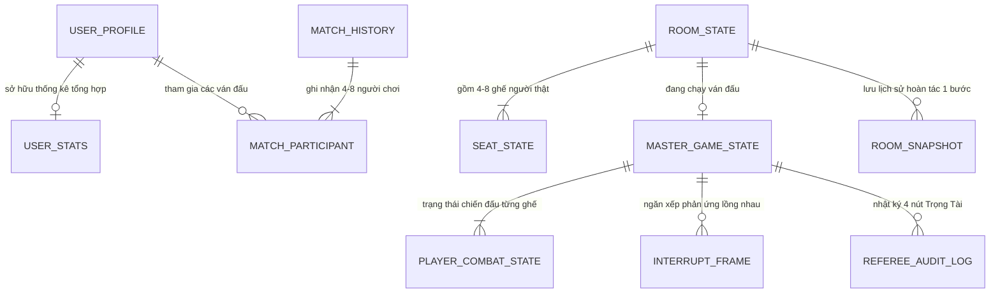

# DATA_MODEL.md — Mô Hình Dữ Liệu, Quyền Truy Cập và Vòng Đời Dữ Liệu

> **Dự án:** LKDF — Game Thẻ Bài Tam Quốc Sát (Windows Native Online 4–8 Người)
> **Cập nhật lần cuối:** 2026-11-16
> **Tài liệu liên quan:** [REQUIREMENTS.md](./REQUIREMENTS.md) · [ARCHITECTURE.md](./ARCHITECTURE.md) · [DESIGN.md](./DESIGN.md)

---

## 1. Sơ Đồ Quan Hệ Dữ Liệu Tổng Thể

---

## 2. Chi Tiết Các Thực Thể Dữ Liệu

### 2.1. Dữ liệu Người dùng & Phân lọc Thống kê (Lưu lâu dài trên Kho dữ liệu Cloud 0đ)

#### `UserProfile` (Hồ sơ tài khoản Google)
| Trường dữ liệu | Kiểu dữ liệu | Mô tả |
| :--- | :--- | :--- |
| `userId` | `string (UUID)` | Mã định danh người dùng duy nhất trong hệ thống. |
| `googleSub` | `string (Unique)` | Mã định danh cố định từ Google OAuth 2.0 (không đổi kể cả khi đổi tên). |
| `email` | `string` | Địa chỉ Gmail đã xác thực của người dùng. |
| `displayName` | `string` | Tên hiển thị trên bàn đấu (mặc định lấy từ Google, cho phép đổi tên hiển thị). |
| `avatarUrl` | `string` | Đường dẫn ảnh đại diện Google hiển thị tại ghế ngồi. |
| `preferences` | `UserPreferences` | Cài đặt cá nhân: `soundEnabled` (bật/tắt âm thanh), `volume` (`0–100`). |
| `activeRoomCode` | `string \| null` | Mã phòng người dùng đang tham gia dở (để tự kết nối lại đúng ghế khi mở lại app). |
| `createdAt` | `ISO Timestamp` | Thời điểm tạo tài khoản lần đầu. |
| `lastLoginAt` | `ISO Timestamp` | Thời điểm đăng nhập gần nhất. |

#### `UserStats` & `MatchParticipant` (Dữ liệu phục vụ Bộ lọc Thống kê theo Người dùng)
| Trường dữ liệu | Kiểu dữ liệu | Mô tả & Mục đích phân lọc |
| :--- | :--- | :--- |
| `userId` | `string` | Khóa liên kết tới `UserProfile`. |
| `totalMatches` | `number` | Tổng số ván đã hoàn thành (không tính ván bị Trọng Tài bấm kết thúc sớm). |
| `totalWins` / `totalLosses` | `number` | Tổng số trận thắng / thua. |
| `byIdentity` | `Record<IdentityRole, { played: number; wins: number }>` | Lọc thống kê thắng/thua theo từng Thân Phận: `LORD` (*Chủ Công*), `LOYALIST` (*Trung Thần*), `REBEL` (*Phản Tặc*), `SPY` (*Nội Gián*). |
| `byHero` | `Record<HeroId, { played: number; wins: number }>` | Lọc thống kê số lần chọn và số trận thắng với từng Tướng trong **25 Tướng chuẩn**. |

#### `MatchHistory` (Lịch sử các ván đã đấu)
| Trường dữ liệu | Kiểu dữ liệu | Mô tả |
| :--- | :--- | :--- |
| `matchId` | `string (UUID)` | Mã ván đấu duy nhất. |
| `roomCode` | `string` | Mã phòng 6 ký tự. |
| `playerCount` | `4 \| 5 \| 6 \| 7 \| 8` | Sĩ số bàn đấu. |
| `winningFaction` | `'LORD_LOYALIST' \| 'REBEL' \| 'SPY'` | Phe giành chiến thắng cuối cùng. |
| `durationSeconds` | `number` | Thời lượng ván đấu (giây). |
| `participants` | `Array<{ userId, displayName, seatIndex, identity, heroId, isWinner, survived }>` | Danh sách 4–8 người chơi kèm Thân Phận, Tướng đã dùng và kết quả thắng/thua. |
| `finishedAt` | `ISO Timestamp` | Thời điểm kết thúc ván. |

---

### 2.2. Dữ liệu Phòng chơi & Ván đấu (`MasterGameState` vs `PlayerViewState`)

#### `RoomState` (Trạng thái Phòng chơi)
- `roomCode`: Mã 6 ký tự in hoa/số (ví dụ `K9M2P4`).
- `status`: `'LOBBY'` (đang ở phòng chờ) | `'IN_GAME'` (đang đánh bài) | `'FINISHED'` (đang ở bảng tổng kết cuối ván).
- `ownerUserId`: Tài khoản Chủ phòng gốc.
- `actingHostUserId`: Tài khoản đang giữ quyền Trọng Tài hiện hành (mặc định bằng `ownerUserId`; tự chuyển sang người online kế tiếp nếu `ownerUserId` mất mạng quá `30 giây`).
- `hostDisconnectedAt`: Thời điểm Chủ phòng gốc bắt đầu mất mạng (hoặc `null` nếu đang online).
- `timerPreset`: `'FAST'` (`20s/30s/10s`) | `'STANDARD'` (`30s/45s/15s`) | `'RELAXED'` (`45s/60s/20s`).
- `isTimerPaused`: `boolean` (trạng thái khi Trọng Tài bấm `[⏸️ Tạm dừng đồng hồ]`).
- `seats`: Danh sách từ **4 đến 8 ghế người chơi thật** (`seatIndex: 0..7`, `userId`, `displayName`, `avatarUrl`, `connectionStatus: 'ONLINE' | 'DISCONNECTED'`, `isBotTakeover: boolean`).

#### `MasterGameState` (Trạng thái thật chỉ nằm trên Máy chủ)
- `matchId`: Mã ván hiện tại.
- `roundNumber`: Số vòng hiện tại.
- `currentTurnSeat`: Ghế đang trong lượt chính.
- `turnPhase`: `'HERO_SELECT'` | `'JUDGE'` (*Phán xét*) | `'DRAW'` (*Rút bài*) | `'PLAY'` (*Đánh bài*) | `'DISCARD'` (*Bỏ bài*) | `'END'` (*Kết lượt*) | `'GAME_OVER'`.
- `drawPile`: Mảng các lá bài đang úp trong chồng bài rút (`Card[]` — tuyệt đối giữ bí mật trên máy chủ).
- `discardPile`: Mảng các lá bài đã bỏ ngửa (`Card[]`).
- `players`: Trạng thái chiến đấu của 4–8 ghế:
  - `identity`: `'LORD'` | `'LOYALIST'` | `'REBEL'` | `'SPY'` (theo đúng bảng: `4 người: 1-0-2-1`, `5 người: 1-1-2-1`, `6 người: 1-1-3-1`, `7 người: 1-2-3-1`, `8 người: 1-2-3-2`).
  - `isIdentityRevealed`: `true` với Chủ Công và người đã chết; `false` với những người còn sống khác.
  - `heroId`: 1 trong 25 mã tướng chuẩn (`liu_bei`, `guan_yu`, `zhang_fei`, `zhuge_liang`, `zhao_yun`, `ma_chao`, `huang_yue_ying`, `cao_cao`, `si_ma_yi`, `xia_hou_dun`, `zhang_liao`, `xu_chu`, `guo_jia`, `zhen_ji`, `sun_quan`, `gan_ning`, `lu_meng`, `huang_gai`, `zhou_yu`, `da_qiao`, `lu_xun`, `sun_shang_xiang`, `hua_tuo`, `lu_bu`, `diao_chan`).
  - `hp` / `maxHp`: Máu hiện tại / Máu tối đa (Chủ Công luôn được `+1 maxHp` ở mọi mốc 4–8 người).
  - `handCards`: Danh sách lá bài trên tay (`Card[]` — chỉ gửi cho đúng chủ nhân của ghế đó).
  - `equipments`: `{ weapon: Card | null, armor: Card | null, plusOneHorse: Card | null, minusOneHorse: Card | null }`.
  - `delayedScrolls`: Danh sách bài trong khu Phán xét (`Lạc Bất Tư Thục`, `Thiểm Điện`).
  - `autoSkipNullification`: `boolean` (trạng thái nút `[☑️ Tự bỏ qua Vô Giải lượt này]`).
- `interruptStack`: Ngăn xếp các pha phản ứng lồng nhau (`InterruptFrame[]`), gồm:
  - Phản ứng *Vô Giải Khả Kích* (có cờ `isSimulatedDelay: boolean` khi dừng giả lập `2.0s–3.5s` lúc không ai có bài để chống lộ thông tin).
  - Phản ứng *Thiểm* (trước *Sát* / *Vạn Tiễn Tề Phát*) hoặc *Sát* (trước *Nam Man Nhập Xâm* / *Quyết Đấu* / *Tá Đao Sát Nhân* / *Kích Tướng*).
  - Phản ứng *Cầu Đào* theo vòng tròn chiều kim đồng hồ khi có người rơi vào trạng thái hấp hối (`hp <= 0`).
  - Phản ứng kỹ năng tướng (*Quỷ Tài, Phản Quỷ, Cương Liệt, Di Kế, Thiên Đố, Lạc Thần, Lưu Ly, Cứu Viện, Hộ Giá...*).
- `actionLog`: Nhật ký hành động công khai trên bàn đấu.
- `refereeAuditLog`: Nhật ký ghi rõ mọi thao tác sử dụng 4 nút Trọng Tài (`timestamp`, `actorUserId`, `actorName`, `actionType: 'PAUSE' | 'RESUME' | 'UNDO_ONE_STEP' | 'SKIP_PHASE' | 'ABORT_MATCH'`).

---

## 3. Phân Quyền Truy Cập Dữ Liệu (Data Access & Visibility Matrix)

| Loại dữ liệu | Bản thân người chơi (Ghế của bạn) | Những người chơi khác trên bàn | Chủ phòng / Trọng Tài tạm thời | Máy chủ (`apps/server`) |
| :--- | :--- | :--- | :--- | :--- |
| **Bài trên tay (`handCards`)** | Xem đầy đủ từng lá bài của mình | Chỉ biết **số lượng lá bài** (`handCount`) | Chỉ biết **số lượng lá bài** (không được soi bài bạn bè) | Biết 100% |
| **Thân Phận (`identity`)** | Biết Thân Phận của mình + Chủ Công + người đã chết | Chỉ biết Chủ Công + người đã chết (lật toàn bộ khi kết thúc ván) | Chỉ biết Chủ Công + người đã chết | Biết 100% |
| **3–5 Tướng được phát lúc đầu ván** | Chỉ thấy các tướng phát cho mình | Chỉ thấy tướng của Chủ Công sau khi Chủ Công chọn xong; thấy tướng mọi người sau khi tất cả chọn xong | Giống người chơi thường | Biết 100% |
| **Chồng bài rút (`drawPile`)** | Chỉ biết số lá còn lại (`drawPileCount`) *(riêng Gia Cát Lượng dùng Quan Tinh chỉ xem được X lá đầu trong pha Quan Tinh)* | Chỉ biết số lá còn lại (`drawPileCount`) | Chỉ biết số lá còn lại (`drawPileCount`) | Biết 100% |
| **4 Nút Bảng Trọng Tài** | Chỉ xem trạng thái & Nhật ký Trọng Tài | Chỉ xem trạng thái & Nhật ký Trọng Tài | **Được quyền bấm thực thi 4 nút** | Xác thực quyền & Thực thi |
| **Thống kê & Lịch sử đấu** | Xem & lọc được thống kê của mình và thành viên trong nhóm | Xem & lọc được thống kê chung của nhóm | Xem & lọc được thống kê chung của nhóm | Lưu trữ & Tổng hợp |

---

## 4. Vòng Đời Dữ Liệu (Data Lifecycle — Tối Ưu Cho Gói Cloud 0 Đồng)

Để đảm bảo gói lưu trữ miễn phí (Cloud 0đ) hoạt động bền bỉ trong nhiều năm mà không bao giờ bị đầy dung lượng:
1. **Bản chụp trạng thái ván đấu (`RoomSnapshot` & Lịch sử Hoàn tác):**
   - Trong khi ván đấu đang diễn ra, máy chủ chỉ giữ **trạng thái hiện tại** + **tối đa 5 bản chụp gần nhất** (để phục vụ nút `[↩️ Hoàn tác 1 bước vừa đánh]` và khôi phục khi máy chủ khởi động lại).
   - Ngay khi ván đấu kết thúc (hoặc khi Trọng Tài bấm `[🏁 Kết thúc ván & Về phòng chờ]`), toàn bộ bản chụp trung gian của ván đó được **xóa sạch**, chỉ giữ lại 1 bản ghi kết quả gọn nhẹ trong `MatchHistory`.
2. **Phòng chơi không hoạt động (`RoomState`):**
   - Phòng chờ không có bất kỳ người chơi nào kết nối trong vòng **2 giờ** sẽ tự động được dọn dẹp khỏi bộ nhớ và kho lưu trữ.
3. **Hồ sơ người dùng & Thống kê (`UserProfile`, `UserStats`, `MatchHistory`):**
   - Được lưu trữ lâu dài vĩnh viễn. Mỗi bản ghi `MatchHistory` chỉ tốn khoảng `~1 KB`, do đó gói cơ sở dữ liệu miễn phí (`500 MB`) có thể lưu trữ hơn **400.000 ván đấu** của nhóm bạn mà không tốn bất kỳ chi phí nào.
