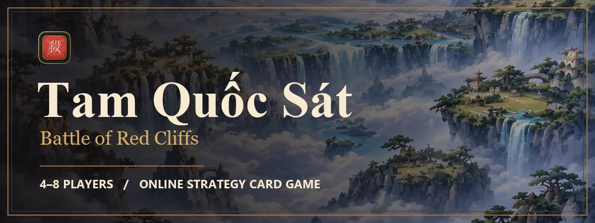
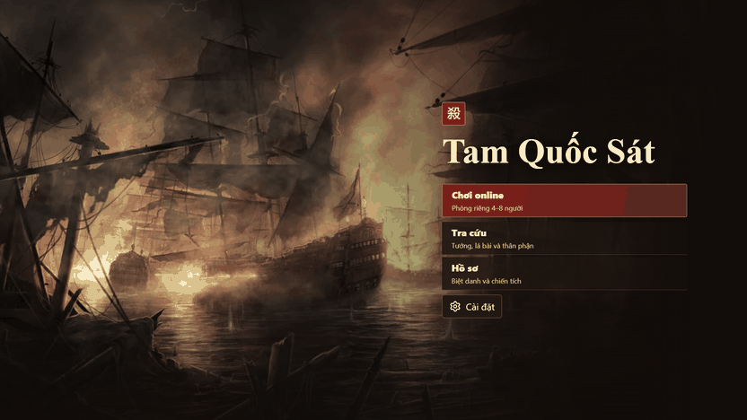
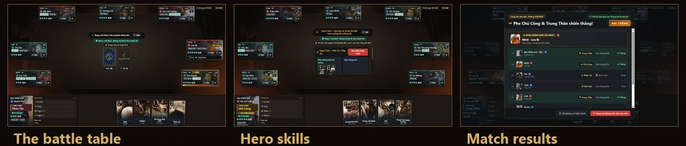

  
  

    
    
  

  
<strong>Windows x64</strong> · v1.0.0 · 122 MB

  
<a href="#install-and-play">Install &amp; play</a> · <a href="#gameplay">Gameplay</a> · <a href="#develop">Build from source</a>

## Install and play

**① GitHub** — Click **Tải game ngay** above, or open [GitHub Releases](https://github.com/Play-with-me/LKDF/releases/tag/v1.0.0) and select **TamQuocSat-Setup-1.0.0.exe** under **Assets**.

**② Alternate link** — Click **Alternative download** above to get the same installer.

1. **Install.** Open the downloaded **.exe** from your **Downloads** folder.
2. **Sign in.** Open **Tam Quoc Sat** from your Desktop or Start menu. Select **Chơi online** and sign in with Google.
3. **Play with friends.** Create a room and share its six-character code, or join with a friend’s code. Start when 4–8 players are ready.

The game interface is in Vietnamese. Online play requires an internet connection and a Google account.

<strong>Cài nhanh bằng tiếng Việt</strong>

Bấm **Tải game ngay** hoặc **Alternative download**. Mở tệp **TamQuocSat-Setup-1.0.0.exe** trong thư mục **Downloads**. Sau đó mở game ở Desktop, chọn **Chơi online**, đăng nhập Google rồi tạo phòng hoặc nhập mã bạn bè gửi.

## Gameplay

  

The Lord plays in the open. Loyalists protect the throne, Rebels aim to topple it, and every Spy wants to win alone. Choose from **25 heroes** and make the most of a **108-card deck**.

  

[Read the full rules (Vietnamese)](RULES_STANDARD.md)

## Develop

<strong>Developer setup, repository layout, and Windows builds</strong>

The Windows full-screen startup fix is available in the source. The published v1.0.0 installer predates that fix.

Use **Node.js 22 or later** and npm. Use Windows to run or package the Electron desktop app.

~~~powershell
git clone https://github.com/Play-with-me/LKDF.git
cd LKDF
npm ci
npm run dev
~~~

The development command runs the shared package watcher, the API on port 3001, and the Electron client with Vite on port 5173. On Windows, use **npm.cmd** if PowerShell blocks **npm.ps1**.

### Preview the battle table without signing in

~~~powershell
npm run build:shared
npm run dev:renderer --workspace=@lkdf/desktop
~~~

Open [the eight-seat preview](http://localhost:5173/?devPreviewSeats=8). Change the seat count to any value from 4 to 8. This development preview runs without the API or Google OAuth.

### Configure online play locally

The server reads environment variables from the process. See [.env.example](.env.example) for names and defaults. For Google sign-in, set **GOOGLE_CLIENT_ID**, **GOOGLE_CLIENT_SECRET**, and **GOOGLE_REDIRECT_URI** in the server environment. Register the same redirect URI with Google. The local default is **http://localhost:3001/api/auth/google/callback**.

The development database defaults to in-memory storage. Set **DATABASE_URL** to a local libSQL file URL for persistence. See the [deployment guide](DEPLOYMENT.md) for production storage, OAuth, and update configuration. Keep server secrets in the server environment.

### Repository layout

| Path | Responsibility |
| --- | --- |
| [apps/desktop](apps/desktop) | Electron Windows client, React interface, input, audio, and updates |
| [apps/server](apps/server) | Fastify HTTP API, WebSocket rooms, Google OAuth, and persistence |
| [packages/shared](packages/shared) | TypeScript rules engine, card and hero data, bot decisions, and per-player game views |
| [scripts](scripts) | Build and asset tooling |

The server owns the full match state and sends each client a filtered view. Opponents' hands, the draw pile's contents, and hidden roles stay private.

### Verify and package

~~~powershell
npm run typecheck
npm run test:unit
npm run test:fuzz
npm run test:integration
npm run build
npm run assets:check
npm run package:win
~~~

The Windows packaging command writes an NSIS installer to **apps/desktop/release/**. Set **VITE_LKDF_SERVER_URL** before building the renderer to target a remote API. For a release, follow the [Windows release workflow](.github/workflows/release-windows.yml), which also sets the Electron server default and installer version.

For in-depth project documentation, see the [architecture](ARCHITECTURE.md), [game rules](RULES_STANDARD.md), [interface design](DESIGN.md), and [test guide](TESTING.md).

