<div align="center">


# 殺 TAM QUỐC SÁT — XÍCH BÍCH ĐẠI CHIẾN
### **Windows Native Online Tactical Card Game · 4–8 Players · Yoka Standard Edition**

[](https://github.com/Play-with-me/LKDF/releases/tag/v1.0.0)
[-CA9A48?style=flat-square&labelColor=14171A)](https://lkdf-tam-quoc-sat-server.onrender.com/api/update/download/TamQuocSat-Setup-1.0.0.exe)
[](https://lkdf-tam-quoc-sat-server.onrender.com/api/health)
[](./RULES_STANDARD.md)
[](./TESTING.md)

<br />

[-TẢI_TRỰC_TIẾP_KHÔNG_CẦN_TÀI_KHOẢN_GITHUB-9E2B25?style=for-the-badge&labelColor=1B130E)](https://lkdf-tam-quoc-sat-server.onrender.com/api/update/download/TamQuocSat-Setup-1.0.0.exe)
&nbsp;&nbsp;
[](https://github.com/Play-with-me/LKDF/releases/tag/v1.0.0)

<br />


<p align="center">
  <a href="#-1-trung-tâm-tải-game--cài-đặt-nhanh-v100"><b>📥 Tải & Cài Đặt</b></a> ·
  <a href="#-2-điểm-nhấn-công-nghệ--trải-nghiệm-chuẩn-studio"><b>✨ Tính Năng Studio</b></a> ·
  <a href="#-3-hướng-dẫn-vào-phòng-điều-khiển--phím-tắt"><b>🎮 Điều Khiển & Phím Tắt</b></a> ·
  <a href="#-4-luật-chơi-chuẩn--chế-độ-thân-phận-48-người"><b>📜 Luật Chơi 4–8 Người</b></a> ·
  <a href="#-5-hồ-sơ-25-danh-tướng--40-kỹ-năng-4-phe"><b>武将 25 Danh Tướng</b></a> ·
  <a href="#-6-bách-khoa-toàn-thư-108-lá-bài-gồm-4-lá-ex"><b>🃏 108 Lá Bài</b></a> ·
  <a href="#-7-kiến-trúc-kỹ-thuật--dành-cho-nhà-phát-triển"><b>🛠️ Kiến Trúc & Kỹ Thuật</b></a>
</p>

</div>

---

## 📥 1. Trung Tâm Tải Game & Cài Đặt Nhanh (`v1.0.0`)

### 1.1. Bảng thông số bản phát hành chính thức (`Release Manifest`)

| Hạng mục | Thông tin chi tiết |
| :--- | :--- |
| **Tên tệp bộ cài** | **`TamQuocSat-Setup-1.0.0.exe`** *(Trình cài đặt NSIS 1-Click, không yêu cầu quyền Admin)* |
| **Phiên bản & Mã bản dựng** | `v1.0.0` (Commit `21634cc` · Phát hành ngày `22/11/2026`) |
| **Dung lượng bộ cài** | **`122 MB`** (`128,318,083 bytes`) |
| **Cổng tải số 1 *(Khuyến nghị)*** | **[⬇️ Tải trực tiếp qua Máy Chủ Cloud (`TamQuocSat-Setup-1.0.0.exe`)](https://lkdf-tam-quoc-sat-server.onrender.com/api/update/download/TamQuocSat-Setup-1.0.0.exe)** *(Mọi người chơi đều tải được ngay, không cần tài khoản GitHub)* |
| **Cổng tải số 2 *(GitHub)*** | **[📦 Tải từ GitHub Releases (`Play-with-me/LKDF`)](https://github.com/Play-with-me/LKDF/releases/download/v1.0.0/TamQuocSat-Setup-1.0.0.exe)** *(Dành cho thành viên có quyền truy cập kho GitHub)* |
| **Mã băm toàn vẹn (`SHA-512`)** | `Jad5y9onfnotbtdr+9q9nd3RMqw/sgU+sSELTUaqqniOZ1E+TahbNrEGpGfy6Joyn0EUqr95ZZgqeM1oz4AiKg==` |
| **Máy chủ mặc định tích hợp** | `https://lkdf-tam-quoc-sat-server.onrender.com` *(Khu vực Singapore · Tự động kết nối)* |
| **Cơ chế nâng cấp phiên bản** | **1-Click In-App Auto-Updater** *(Tự báo và tải bản vá ngay trong ứng dụng từ `v1.0.1+`)* |

### 1.2. Cấu hình hệ thống (System Requirements)

| Thành phần | Cấu hình Tối thiểu | Cấu hình Khuyến nghị |
| :--- | :--- | :--- |
| **Hệ điều hành** | Windows 10 (64-bit, bản 1903 trở lên) | Windows 10 / Windows 11 (64-bit) |
| **Bộ vi xử lý (CPU)** | Dual-Core 2.0 GHz | Quad-Core 2.5 GHz trở lên |
| **Bộ nhớ (RAM)** | 4 GB RAM | 8 GB RAM |
| **Độ phân giải màn hình** | `960 × 600` *(Hỗ trợ chế độ Giảm chuyển động)* | `1280 × 720` (HD) · `1920 × 1080` (FHD) · `2560 × 1440` (2K) |
| **Dung lượng ổ cứng trống** | 400 MB | 600 MB SSD |
| **Kết nối mạng** | Băng thông rộng ổn định (WebSocket TLS) | Ping tới Singapore `< 80ms` |

### 1.3. Quy trình cài đặt & đăng nhập lần đầu (60 giây)

1. **Bước 1 — Chạy bộ cài đặt:** Tải **`TamQuocSat-Setup-1.0.0.exe`** về máy và nhấp đúp chuột. Ứng dụng tự động cài vào thư mục người dùng và mở ngay lên màn hình kèm biểu tượng ngoài Desktop.
2. **Bước 2 — Vượt cảnh báo Windows SmartScreen (chỉ lần đầu tiên):**
   > [!IMPORTANT]
   > Vì đây là bản phát hành nội bộ không mua chứng chỉ chữ ký số thương mại của Microsoft (EV Code Signing), ở lần chạy đầu tiên Windows Defender có thể hiện bảng màu xanh **"Windows protected your PC"**. Bạn chỉ cần bấm vào dòng chữ **`More info`** → bấm nút **`Run anyway`** là vào game bình thường.
3. **Bước 3 — Tự động đánh thức máy chủ & Đăng nhập Google:**
   - Ứng dụng trỏ sẵn về máy chủ Cloud Singapore. Nếu máy chủ đang ở trạng thái nghỉ (sau 15 phút không có phòng chơi), màn hình sẽ hiện bộ đếm tự động đánh thức máy chủ trong khoảng **`30–50 giây`**.
   - Bấm **`🔑 Đăng nhập bằng Google`** → xác nhận tài khoản Gmail trên trình duyệt → đặt **Biệt danh hiển thị** (`2–20 ký tự`) ở lần đầu vào game. *(Các lần mở app sau hệ thống tự động khôi phục phiên đăng nhập)*.
4. **Bước 4 — Cập nhật 1-Click cho các bản về sau:**
   > [!TIP]
   > Bạn chỉ cần cài file `.exe` duy nhất 1 lần này. Khi có bản nâng cấp mới (`v1.0.1`, `v1.0.2`...), ứng dụng sẽ tự hiện hộp thoại **`🔔 Đã có phiên bản mới!`** — bấm **`⬇️ Cập nhật ngay`** để game tự tải, đối chiếu `SHA-512` và khởi động lại.

---

## ✨ 2. Điểm Nhấn Công Nghệ & Trải Nghiệm Chuẩn Studio

<div align="center">
  
</div>

| Trụ cột thiết kế | Công nghệ & Trải nghiệm thực tế trong trận |
| :--- | :--- |
| **🎨 Giao diện Quốc Phong & Thẻ bài Gwent Full-Bleed** | Khung bàn đấu gỗ mun khảm đồng cổ kết hợp chân dung tướng tràn viền 3 lớp sáng tối. Cố định `100vh` **không thanh cuộn** trên mọi kích thước cửa sổ từ `960×600` đến `2K`, đảm bảo **`0px` chồng lấn** giữa 8 ghế, tâm bàn và dải bài tay. |
| **⚡ VFX Canvas 2D 60fps & Cảm giác lực (`Combat Juice`)** | Hệ thống hạt & hiệu ứng vẽ trực tiếp trên `<canvas>` (tự ngắt vòng lặp `rAF` khi bàn rảnh): nhát chém *Sát*, lốc *Thiểm*, hoa đào hồi máu, sấm sét *Thiểm Điện*, vỡ ấn *Vô Giải*, đường cung nhắm Bézier từ mép lá bài tới tâm ghế đích, kèm **hit-stop `55ms`**, giật ghế theo hướng đòn và rung chấn `trauma²`. |
| **🔊 Âm thanh Không gian (`Stereo Panning`) & 40 Mẫu Foley Thật** | Bàn trộn Web Audio 4 kênh tích hợp `DynamicsCompressorNode` Limiter, Auto-Ducking (`-9 dB` khi có tiếng chiêu/sát thương), định vị âm thanh trái–phải theo đúng tọa độ ghế trên bàn tròn, nhạc chiến trường Xích Bích chuyển pha Cao Trào `108 BPM` đồng bộ mẫu âm thanh, cùng 38 âm Foley vật liệu thật (thép rèn, giấy bồi, gỗ mun, trống trận, dây đàn cổ). |
| **🛡️ Lõi Luật Thuần Khiết & Bảo Mật Giấu Bài Tuyệt Đối** | Toàn bộ luật 108 lá & 25 tướng chạy trên máy chủ qua bộ lọc `projectStateForPlayer`. Máy khách của từng người **chỉ nhận được bài trên tay mình**, tuyệt đối không bao giờ nhận được mã lá bài úp của đối thủ, thứ tự chồng bài rút hay Thân Phận ẩn trên đường truyền mạng. |
| **🔄 Chống Rớt Mạng, Máy Đánh Hộ & Tái Đấu Tức Thì** | Tự động kết nối lại (`Auto-Reconnect`) giữ nguyên ghế và tay bài; quá giờ hoặc rớt mạng tự chuyển **Máy đánh hộ tạm thời** để bàn không bao giờ treo. Chơi xong 1 ván bấm **`Quay về phòng chờ chơi ván mới`** để tái đấu ngay. |

---

## 🎮 3. Hướng Dẫn Vào Phòng, Điều Khiển & Phím Tắt

### 3.1. Lưu đồ vào trận của nhóm 4–8 người

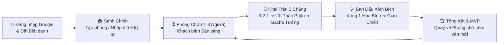

### 3.2. Ba phương thức thao tác lá bài
1. **Nhấn giữ & Quăng bài (Tactile Drag & Drop):** Nhấn giữ chuột trái vào lá bài trên tay (lá bài nghiêng theo quán tính kéo) rồi thả vào lòng bàn tròn (đối với *Đào, Vô Trung Sinh Hữu, Trang bị, Nam Man, Vạn Tiễn, Ngũ Cốc, Đào Viên, Thiểm Điện*) hoặc thả thẳng lên ghế đối thủ đang sáng viền vàng (đối với *Sát, Quyết Đấu, Thuận Thủ, Quá Hà, Lạc Bất Tư Thục* — tâm ghế sẽ tự hút nhẹ thẻ bài ở tỉ lệ `1.08x`).
2. **Nhấp đúp chuột (Double-Click Quick Play):** Nhấp đúp chuột trái vào bất kỳ lá Trang bị hoặc bài không cần chọn mục tiêu để mặc/thi triển ngay lập tức.
3. **Tổ hợp phím tắt tốc độ cao:**

| Phím tắt | Chức năng điều khiển |
| :---: | :--- |
| <kbd>1</kbd> – <kbd>9</kbd> | Chọn hoặc bỏ chọn nhanh lá bài thứ `1..9` trên tay (tính từ trái sang phải) |
| <kbd>Enter</kbd> / <kbd>Space</kbd> | Thực thi ngay hành động chính đang sáng trên thanh lệnh (*Đánh bài, Kích hoạt kỹ năng, Đánh Vô Giải...*) |
| <kbd>Esc</kbd> | Hủy chọn toàn bộ lá bài, mục tiêu hoặc tắt chế độ chuyển đổi kỹ năng đang mở |
| <kbd>E</kbd> | Kết thúc ngay pha Đánh bài hiện tại để sang pha Bỏ bài / Kết lượt |

### 3.3. Hệ thống tín hiệu thị giác trên bàn đấu
- **`#1` .. `#8` (cạnh tên người chơi):** Thứ tự đi lượt cố định theo chiều kim đồng hồ.
- **`🚩 Lượt` / `🚩 Lượt chính của bạn` (Vàng kim):** Ghế đang nắm lượt chính hiện tại.
- **`🚩 Chờ` (Vàng nhạt):** Ghế đang trong lượt chính nhưng tạm dừng chờ người chơi khác phản ứng.
- **`⚡ Phản ứng` / `⚡ Bạn đang phản ứng` (Cam đỏ):** Ghế đang phải đưa ra phản ứng tức thời (*né Thiểm, ra Sát Quyết Đấu/Nam Man, cứu Đào, đánh Vô Giải...*).
- **`🎯 ... đang ... vào BẠN!` (Cảnh báo đỏ giữa bàn):** Phát sáng tức thì mỗi khi bạn là mục tiêu trực tiếp của lá bài hoặc kỹ năng từ đối thủ.
- **`📣 ...` (Dải chiếu diễn biến trung tâm):** Ghi rõ người vừa dùng kỹ năng/lá bài gì lên ai, kèm **3 lá bài đánh ra gần nhất xếp thẳng hàng tách rời** (`0px` đè mặt bài).

---

## 📜 4. Luật Chơi Chuẩn & Chế Độ Thân Phận (4–8 Người)

### 4.1. Bảng phân bổ Thân Phận & Điều kiện chiến thắng
Hệ thống xào bài & thân phận bằng bộ sinh số ngẫu nhiên mật mã **3 lượt liên hoàn** (*Fisher-Yates xuôi → Riffle & Cut → Fisher-Yates ngược*). Thân phận của **Chủ Công** luôn lật ngửa (được **`+1` Máu tối đa**); các ghế còn lại giữ kín cho tới khi tử trận hoặc kết thúc ván:

| Quy mô bàn đấu | 👑 Chủ Công | 🛡️ Trung Thần | ⚔️ Phản Tặc | 🎭 Nội Gián | Tổng số |
| :---: | :---: | :---: | :---: | :---: | :---: |
| **Bàn 4 người** | 1 | 1 | 1 | 1 | **4** |
| **Bàn 5 người** | 1 | 1 | 2 | 1 | **5** |
| **Bàn 6 người** | 1 | 1 | 3 | 1 | **6** |
| **Bàn 7 người** | 1 | 2 | 3 | 1 | **7** |
| **Bàn 8 người** | 1 | 2 | 4 | **2** *(Đấu riêng)* | **8** |

- **👑 Chủ Công & 🛡️ Trung Thần:** Thắng khi tiêu diệt hết toàn bộ **Phản Tặc** và **Nội Gián**.
- **⚔️ Phản Tặc:** Thắng ngay khi **Chủ Công** tử trận *(trừ khi Nội Gián là người duy nhất còn sống hạ gục Chủ Công ở thế 1v1)*.
- **🎭 Nội Gián:** Phải chờ toàn bộ Trung Thần, Phản Tặc (và Nội Gián còn lại ở bàn 8 người) tử trận hết, sau đó **đơn đấu 1v1 hạ gục Chủ Công** mới giành chiến thắng.
- **Thưởng & Phạt kết liễu:**
  - **Thưởng diệt Phản Tặc:** Bất kỳ ai (kể cả Phản Tặc khác) tự tay kết liễu một **Phản Tặc** được **rút thưởng ngay 3 lá bài**.
  - **Phạt Chủ Công giết nhầm Trung Thần:** Nếu **Chủ Công** tự tay kết liễu một **Trung Thần**, Chủ Công phải **hủy bỏ toàn bộ bài trên tay và toàn bộ trang bị đang mặc**.

### 4.2. Luật Vòng 1 Hòa Bình & Cấu trúc 6 pha trong lượt

> [!NOTE]
> **🕊️ Luật Vòng 1 Hòa Bình (`roundNumber === 1`):**
> Tính từ lượt đầu tiên của **Chủ Công** đi giáp 1 vòng theo chiều kim đồng hồ qua tất cả các ghế:
> 1. **Không rút thêm 2 lá ở pha Rút bài:** Mọi người chơi giữ nguyên **4 lá bài khởi đầu** được chia đầu ván để tính toán chiến thuật.
> 2. **Cấm chủ động đánh `Sát`:** Không ai được chủ động đánh `Sát`, chuyển hóa bài thành `Sát` (*Võ Thánh, Long Đảm, Trượng Bát Xà Mâu*) hay phát động *Kích Tướng* trong pha Đánh bài của Vòng 1. *(Các lá Trang bị, Đào, Cẩm nang và việc đánh `Sát` để đáp trả Nam Man / Quyết Đấu / Tá Đao vẫn hoạt động bình thường)*.
> 3. Ngay khi lượt quay về lại ghế **Chủ Công** (**bắt đầu Vòng 2**), pha Rút 2 lá và quyền đánh `Sát` tự động mở khóa cho toàn bàn.

| Thứ tự Pha | Tên Pha | Quy tắc giải quyết tự động trong Engine |
| :---: | :--- | :--- |
| **Pha 1** | **Bắt đầu lượt** | Kiểm tra kỹ năng đầu lượt (*Gia Cát Lượng — Quan Tinh*, *Chân Cơ — Lạc Thần*). |
| **Pha 2** | **Phán xét (`JUDGE`)** | Phán xét các lá Cẩm nang thời gian theo quy tắc **đặt sau phán xét trước (LIFO)**. Cho phép **đặt chồng nhiều lá `Lạc Bất Tư Thục` hoặc `Thiểm Điện`** lên cùng 1 ghế; nếu lá *Lạc* đầu tiên đã làm mất pha Đánh bài thì các lá *Lạc* còn lại trên ghế đó được **bảo lưu sang vòng sau** mới phán xét tiếp. |
| **Pha 3** | **Rút bài (`DRAW`)** | Vòng 1 bỏ qua rút bài; từ Vòng 2 rút **2 lá** (hoặc *Anh Tư* rút 3 lá, *Đột Tập* lấy bài tay 1–2 người, *Lõa Y* rút 1 lá tăng `+1` sát thương). |
| **Pha 4** | **Đánh bài (`PLAY`)** | Mặc trang bị, dùng Cẩm nang, bật kỹ năng chủ động và đánh tối đa **1 lá `Sát`/lượt** *(không giới hạn nếu trang bị **Gia Cát Liên Nỗ** hoặc là **Trương Phi — Phao Hống**)*. |
| **Pha 5** | **Bỏ bài (`DISCARD`)** | Số bài giữ lại trên tay tối đa bằng **Máu hiện tại (`HP`)**; phần dư phải bỏ xuống chồng bài bỏ *(trừ khi kích hoạt **Lữ Mông — Khắc Kỷ**)*. |
| **Pha 6** | **Kết thúc lượt (`END`)** | Kiểm tra kỹ năng cuối lượt (*Điêu Thuyền — Bế Nguyệt* rút 1 lá) và chuyển lượt theo chiều kim đồng hồ. |

---

## 武将 5. Hồ Sơ 25 Danh Tướng & 40 Kỹ Năng (4 Phe)

### 🔴 Phe Thục Hán (7 Danh Tướng)

| Chân dung | Danh tướng | Máu | Kỹ năng & Cơ chế chuẩn |
| :---: | :--- | :---: | :--- |
| 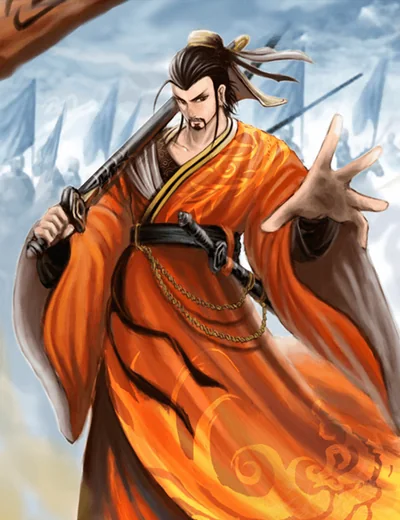 | **Lưu Bị**<br/>*(Chủ Công)* | **4**<br/>*(+1)* | **• Nhân Đức:** Trong pha Đánh bài, giao bất kỳ số bài trên tay cho đồng đội; lần đầu giao đủ từ 2 lá trở lên trong lượt được hồi `+1` máu.<br/>**• Kích Tướng *(Chủ Công)*:** Khi cần dùng hoặc đánh `Sát`, có thể kêu gọi các tướng phe **Thục** khác đánh `Sát` hộ mình. |
| 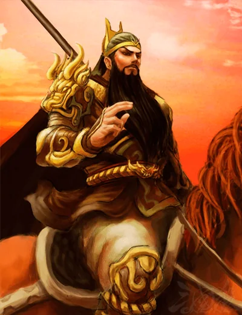 | **Quan Vũ** | **4** | **• Võ Thánh:** Bạn có thể dùng hoặc đánh ra bất kỳ lá bài **màu Đỏ (`♥`/`♦`)** nào trên tay hoặc trong ô trang bị như lá **`Sát`**. |
| 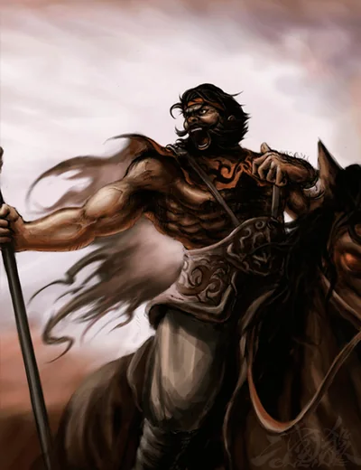 | **Trương Phi** | **4** | **• Phao Hống:** Bạn được sử dụng **không giới hạn số lá `Sát`** trong pha Đánh bài (từ Vòng 2). |
|  | **Gia Cát Lượng** | **3** | **• Quan Tinh:** Đầu lượt, bí mật xem `min(5, số người còn sống)` lá đầu chồng bài rút, tùy ý xếp lên đỉnh hoặc đưa xuống đáy chồng bài.<br/>**• Không Thành:** Khi không còn bài trên tay (`0` lá), bạn miễn nhiễm hoàn toàn với **`Sát`** và **`Quyết Đấu`**. |
| 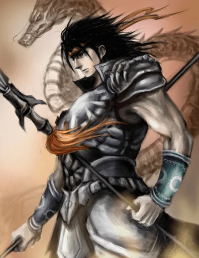 | **Triệu Vân** | **4** | **• Long Đảm:** Bạn có thể dùng lá **`Sát` như lá `Thiểm`**, và dùng lá **`Thiểm` như lá `Sát`**. |
| 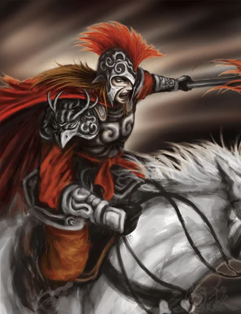 | **Mã Siêu** | **4** | **• Mã Thuật:** Khoảng cách từ bạn tới người khác luôn được **`-1`** (cộng dồn với Ngựa `-1`).<br/>**• Thiết Kỵ:** Khi đánh `Sát` chỉ định mục tiêu, có thể phán xét: nếu ra **chất Đỏ (`♥`/`♦`)**, mục tiêu không thể dùng `Thiểm`. |
|  | **Hoàng Nguyệt Anh** | **3** | **• Tập Trí:** Mỗi khi bạn sử dụng 1 lá **Cẩm nang thường** (không phải thời gian), bạn rút ngay **1 lá bài**.<br/>**• Kỳ Tài:** Bạn dùng mọi lá Cẩm nang (kể cả *Thuận Thủ Khiên Dương*) mà **không bị giới hạn khoảng cách**. |

### 🔵 Phe Tào Ngụy (7 Danh Tướng)

| Chân dung | Danh tướng | Máu | Kỹ năng & Cơ chế chuẩn |
| :---: | :--- | :---: | :--- |
| 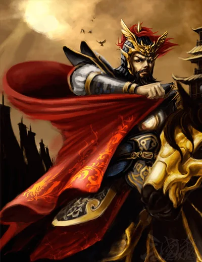 | **Tào Tháo**<br/>*(Chủ Công)* | **4**<br/>*(+1)* | **• Gian Hùng:** Sau khi chịu sát thương, bạn thu ngay lá bài vật lý đã gây sát thương đó về tay.<br/>**• Hộ Giá *(Chủ Công)*:** Khi cần dùng `Thiểm`, có thể kêu gọi các tướng phe **Ngụy** khác đánh `Thiểm` (hoặc phán xét *Bát Quái Trận*) hộ mình. |
| 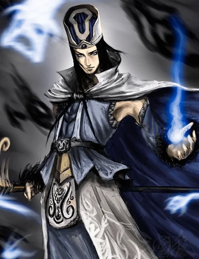 | **Tư Mã Ý** | **3** | **• Phản Quỹ:** Mỗi khi chịu sát thương, bạn lấy ngay **1 lá bài** (tay hoặc trang bị) của nguồn gây sát thương về tay.<br/>**• Quỷ Tài:** Trước khi lá phán xét của bất kỳ ai có hiệu lực, bạn có thể đánh 1 lá trên tay ra thay thế làm lá phán xét mới. |
| 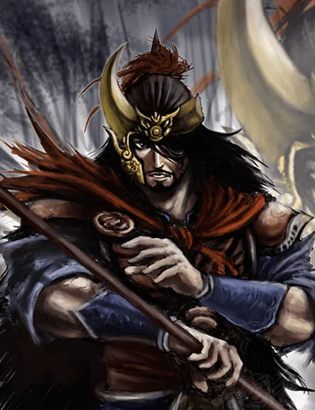 | **Hạ Hầu Đôn** | **4** | **• Cương Liệt:** Sau khi chịu sát thương, có thể lật phán xét: nếu **không phải chất Cơ (`♥`)**, nguồn gây sát thương phải chọn bỏ 2 lá trên tay hoặc chịu 1 sát thương. |
| 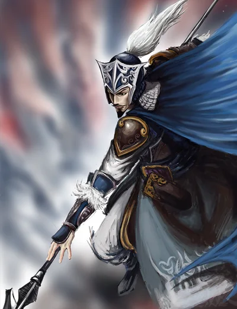 | **Trương Liêu** | **4** | **• Đột Tập:** Ở pha Rút bài (từ Vòng 2), có thể bỏ rút 2 lá để lấy mỗi người **1 lá bài trên tay** của từ **1 đến 2 người chơi khác**. |
| 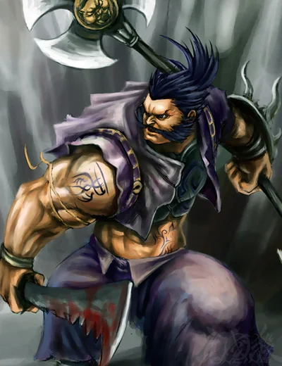 | **Hứa Chử** | **4** | **• Lõa Y:** Ở pha Rút bài (từ Vòng 2), có thể rút ít đi 1 lá; đổi lại trong lượt đó sát thương từ **`Sát`** hoặc **`Quyết Đấu`** của bạn được **`+1` sát thương**. |
|  | **Quách Gia** | **3** | **• Thiên Đố:** Khi lá phán xét của bạn vừa có kết quả, bạn thu luôn lá phán xét đó về tay.<br/>**• Di Kế:** Mỗi khi mất **1 máu**, bạn rút ngay **2 lá bài** và có thể phân phát tùy ý 2 lá đó cho bất kỳ người chơi nào. |
|  | **Chân Cơ** | **3** | **• Lạc Thần:** Đầu lượt, có thể lật phán xét liên tiếp: cứ ra **chất Đen (`♠`/`♣`)** thì thu về tay và lật tiếp cho tới khi ra Đỏ hoặc dừng.<br/>**• Khuynh Quốc:** Bạn có thể dùng bất kỳ lá bài **chất Đen (`♠`/`♣`)** nào trên tay như lá **`Thiểm`**. |

### 🟢 Phe Đông Ngô (8 Danh Tướng)

| Chân dung | Danh tướng | Máu | Kỹ năng & Cơ chế chuẩn |
| :---: | :--- | :---: | :--- |
| 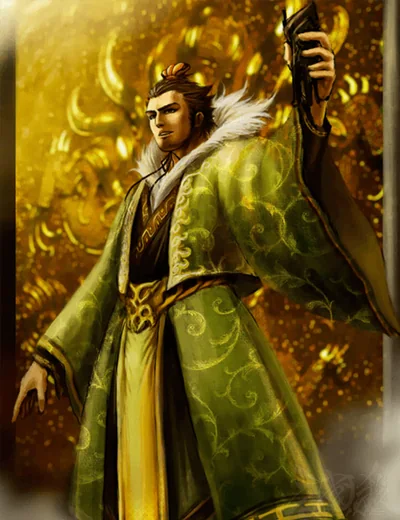 | **Tôn Quyền**<br/>*(Chủ Công)* | **4**<br/>*(+1)* | **• Chế Hành:** Trong pha Đánh bài (1 lần/lượt), bỏ bất kỳ số lá bài (tay hoặc trang bị) và rút lại đúng bấy nhiêu lá.<br/>**• Cứu Viện *(Chủ Công)*:** Khi bạn đang Hấp hối mà được một tướng phe **Ngô** khác dùng `Đào` cứu, bạn hồi thêm **`+1` máu**. |
|  | **Cam Ninh** | **4** | **• Kỳ Tập:** Trong pha Đánh bài, bạn có thể dùng bất kỳ lá bài **chất Đen (`♠`/`♣`)** nào (tay hoặc trang bị) như **`Quá Hà Sái Cầu`**. |
| 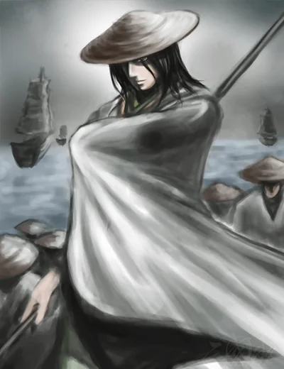 | **Lữ Mông** | **4** | **• Khắc Kỷ:** Nếu trong pha Đánh bài bạn **không dùng và không đánh ra lá `Sát` nào**, bạn được bỏ qua pha Bỏ bài (ôm bài không giới hạn). |
|  | **Hoàng Cái** | **4** | **• Khổ Nhục:** Trong pha Đánh bài (không giới hạn số lần), tự mất **1 máu** để rút ngay **2 lá bài**. |
| 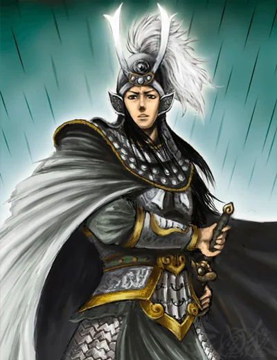 | **Chu Du** | **3** | **• Anh Tư:** Ở pha Rút bài (từ Vòng 2), bạn rút **3 lá bài** thay vì 2 lá.<br/>**• Phản Gián:** Trong pha Đánh bài (1 lần/lượt), chọn 1 đối thủ đoán chất bài rồi rút 1 lá trên tay bạn: đoán sai chất chịu **1 sát thương** và vẫn giữ lá đó. |
| 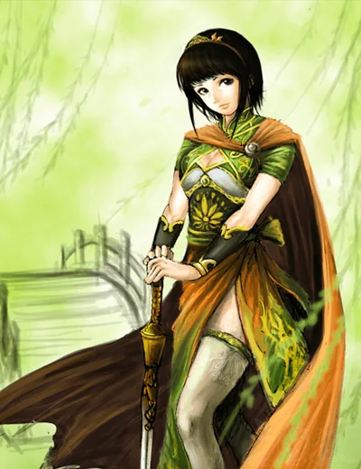 | **Đại Kiều** | **3** | **• Quốc Sắc:** Trong pha Đánh bài, dùng bất kỳ lá bài **chất Rô (`♦`)** nào (tay hoặc trang bị) như **`Lạc Bất Tư Thục`**.<br/>**• Lưu Ly:** Khi bị nhắm bởi `Sát`, có thể bỏ 1 lá bài để chuyển đòn `Sát` sang 1 người khác trong tầm đánh của bạn (trừ người vừa đánh `Sát`). |
| 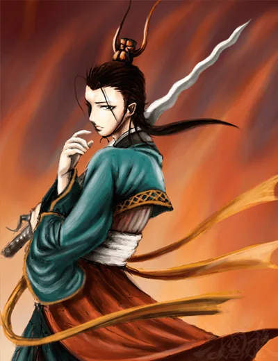 | **Lục Tốn** | **3** | **• Khiêm Tốn:** Bạn miễn nhiễm hoàn toàn với **`Thuận Thủ Khiên Dương`** và **`Lạc Bất Tư Thục`**.<br/>**• Liên Doanh:** Bất cứ khi nào bạn mất đi lá bài cuối cùng trên tay (`về 0 lá`), bạn rút ngay **1 lá bài**. |
| 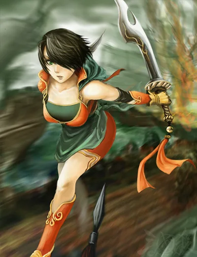 | **Tôn Thượng Hương** | **3** | **• Kết Hôn:** Trong pha Đánh bài (1 lần/lượt), bỏ 2 lá trên tay và chọn 1 **tướng Nam đang mất máu**: cả hai cùng hồi **`+1` máu**.<br/>**• Kiêu Cơ:** Mỗi khi bạn mất đi 1 lá bài đang mặc trong **4 ô Trang bị**, bạn rút ngay **2 lá bài**. |

### ⚪ Phe Quần Hùng (3 Danh Tướng)

| Chân dung | Danh tướng | Máu | Kỹ năng & Cơ chế chuẩn |
| :---: | :--- | :---: | :--- |
| 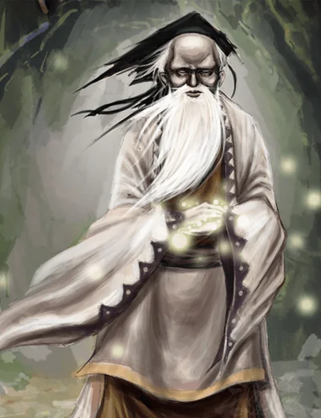 | **Hoa Đà** | **3** | **• Thanh Nang:** Trong pha Đánh bài (1 lần/lượt), bỏ 1 lá trên tay để hồi **`+1` máu** cho bất kỳ người chơi nào.<br/>**• Cấp Cứu:** Ngoài lượt của mình, bạn có thể dùng bất kỳ lá bài **chất Đỏ (`♥`/`♦`)** nào (tay hoặc trang bị) như lá **`Đào`**. |
| 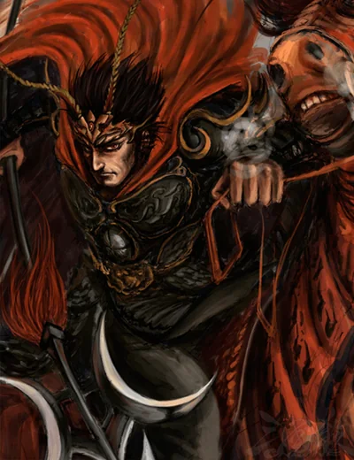 | **Lữ Bố** | **4** | **• Vô Song:** Khi bạn đánh `Sát`, mục tiêu phải dùng **2 lá `Thiểm`** mới né được; khi bạn **Quyết Đấu**, đối thủ phải ra **2 lá `Sát`** mỗi lượt đáp trả. |
|  | **Điêu Thuyền** | **3** | **• Ly Gián:** Trong pha Đánh bài (1 lần/lượt), bỏ 1 lá bài và chọn **2 tướng Nam khác nhau** để buộc họ **Quyết Đấu** với nhau.<br/>**• Bế Nguyệt:** Ở pha Kết thúc lượt, bạn được rút thêm **1 lá bài**. |

---

## 🃏 6. Bách Khoa Toàn Thư 108 Lá Bài (Gồm 4 Lá EX)

### 6.1. Bài Cơ Bản (53 Lá)

| Minh họa | Tên lá bài | Số lượng | Tác dụng & Quy tắc sử dụng |
| :---: | :--- | :---: | :--- |
| 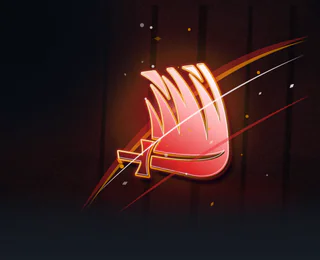 | **Sát (殺)** | **30 lá** | Công kích 1 mục tiêu trong tầm vũ khí (1 lần/lượt ở pha Đánh bài từ Vòng 2). Mục tiêu đánh 1 lá **Thiểm** để né, nếu không mất 1 máu. |
|  | **Thiểm (閃)** | **15 lá** | Dùng phản ứng ngoài lượt khi bị nhắm bởi **Sát** hoặc **Vạn Tiễn Tề Phát** để hóa giải sát thương. |
|  | **Đào (桃)** | **8 lá** | Dùng trong pha Đánh bài để tự hồi `+1` máu (khi chưa đầy máu), hoặc dùng ngoài lượt cứu người đang **Hấp hối (`<= 0` máu)**. |

### 6.2. Cẩm Nang Thường & Cẩm Nang Thời Gian (36 Lá)

| Minh họa | Tên Cẩm nang | Phân loại | Số lượng | Tác dụng & Quy tắc giải quyết |
| :---: | :--- | :---: | :---: | :--- |
|  | **Vô Trung Sinh Hữu** | Đơn mục tiêu | **4 lá** | Tự dùng cho bản thân: rút ngay **2 lá bài**. |
|  | **Quá Hà Sái Cầu** | Đơn mục tiêu | **6 lá** | Chọn 1 người chơi khác (bất kể khoảng cách) còn bài: hủy 1 lá bài trên tay, trang bị hoặc lá phán xét của họ. |
|  | **Thuận Thủ Khiên Dương** | Đơn mục tiêu | **5 lá** | Chọn 1 người chơi khác ở **khoảng cách `1`** (không giới hạn nếu có *Kỳ Tài*) còn bài: lấy 1 lá bài (tay, trang bị hoặc phán xét) của họ về tay bạn. |
| 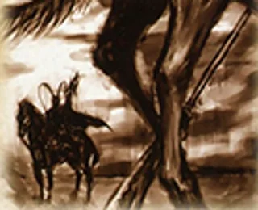 | **Quyết Đấu** | Đơn mục tiêu | **3 lá** | Chọn 1 người chơi khác: bắt đầu từ mục tiêu, hai bên luân phiên đánh ra 1 lá **Sát**. Ai không ra được `Sát` trước sẽ chịu 1 sát thương. |
|  | **Tá Đao Sát Nhân** | Đơn mục tiêu | **2 lá** | Chọn 1 người khác đang cầm **Vũ khí** và 1 mục tiêu trong tầm đánh của họ: họ phải đánh `Sát` vào mục tiêu đó hoặc giao Vũ khí cho bạn. |
| 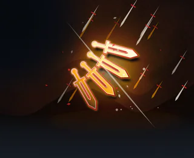 | **Nam Man Nhập Xâm** | Toàn bàn | **3 lá** | Tất cả người chơi khác theo chiều kim đồng hồ lần lượt phải đánh ra 1 lá **Sát**, nếu không chịu 1 sát thương từ bạn. |
| 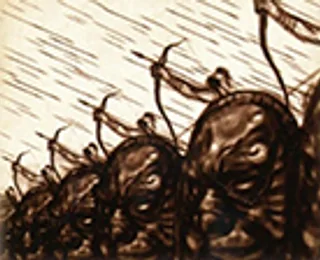 | **Vạn Tiễn Tề Phát** | Toàn bàn | **1 lá** | Tất cả người chơi khác theo chiều kim đồng hồ lần lượt phải đánh ra 1 lá **Thiểm**, nếu không chịu 1 sát thương từ bạn. |
|  | **Đào Viên Kết Nghĩa** | Toàn bàn | **1 lá** | Tất cả người chơi còn sống đang mất máu được hồi ngay **`+1` máu**. |
|  | **Ngũ Cốc Phong Đăng** | Toàn bàn | **2 lá** | Lật ngửa số lá bằng số người còn sống ra giữa bàn; từ bạn theo chiều kim đồng hồ, mỗi người chọn lấy 1 lá về tay. |
|  | **Vô Giải Khả Kích** | Phản ứng | **4 lá** | Chặn hiệu lực của 1 lá Cẩm nang sắp tác động lên 1 mục tiêu (hoặc phản chặn chính 1 lá *Vô Giải Khả Kích* khác). |
|  | **Lạc Bất Tư Thục** | Thời gian | **3 lá** | Đặt vào khu Phán xét của 1 người khác (có thể chồng nhiều lá). Đến pha Phán xét của họ, lật 1 lá: nếu **khác chất Cơ (`♥`)** thì họ **mất pha Đánh bài** lượt đó. |
|  | **Thiểm Điện (Sét)** | Thời gian | **2 lá**<br/>*(`1♠`, `Q♥` EX)* | Đặt vào khu Phán xét của bản thân (có thể chồng nhiều lá). Đến pha Phán xét, lật 1 lá: trúng **`2♠`–`9♠`** chịu **3 sát thương sấm sét**; trượt thì chuyền sang người kế tiếp. |

### 6.3. Trang Bị: Vũ Khí · Phòng Cụ · Chiến Mã (19 Lá — 4 Ô Trang Bị Ngửa)

| Minh họa | Tên trang bị | Ô trang bị | Tầm / Chỉ số | Kỹ năng trang bị |
| :---: | :--- | :---: | :---: | :--- |
|  | **Gia Cát Liên Nỗ** *(×2)* | Vũ khí | Tầm **1** | Cho phép đánh **không giới hạn số lá `Sát`** trong pha Đánh bài. |
|  | **Thanh Công Kiếm** | Vũ khí | Tầm **2** | Mọi đòn `Sát` của bạn **bỏ qua hoàn toàn Giáp** của mục tiêu. |
|  | **Từ Hùng Song Cổ Kiếm** | Vũ khí | Tầm **2** | Khi đánh `Sát` vào tướng **khác giới tính**, mục tiêu phải chọn bỏ 1 lá trên tay hoặc cho bạn rút 1 lá bài trước khi né. |
|  | **Hàn Băng Kiếm** *(EX)* | Vũ khí | Tầm **2** | Khi `Sát` trúng mục tiêu còn bài, có thể ngăn sát thương để **lần lượt hủy tối đa 2 lá bài** (tay hoặc trang bị) của họ. |
|  | **Quán Thạch Phủ** | Vũ khí | Tầm **3** | Khi mục tiêu dùng `Thiểm` né `Sát`, bạn có thể bỏ **2 lá bài khác** của mình để ép đòn `Sát` vẫn gây sát thương. |
| 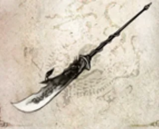 | **Thanh Long Yển Nguyệt Đao** | Vũ khí | Tầm **3** | Khi `Sát` bị né bằng `Thiểm`, bạn được đánh bồi tiếp `Sát` vào chính mục tiêu đó (không giới hạn số lần truy kích). |
|  | **Trượng Bát Xà Mâu** | Vũ khí | Tầm **3** | Dùng bất kỳ **2 lá bài trên tay** để đánh ra hoặc phản ứng như **1 lá `Sát`**. |
|  | **Phương Thiên Họa Kích** | Vũ khí | Tầm **4** | Khi lá `Sát` đánh ra là **lá bài cuối cùng trên tay**, được chỉ định tới **tối đa 3 mục tiêu** trong tầm đánh. |
|  | **Kỳ Lân Cung** | Vũ khí | Tầm **5** | Khi `Sát` gây sát thương cho mục tiêu có cưỡi Ngựa (`+1` hoặc `-1`), bạn được chọn hủy 1 con Ngựa của họ. |
| 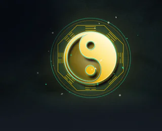 | **Bát Quái Trận** *(×2)* | Giáp | Phòng cụ | Mỗi khi cần dùng `Thiểm`, được lật phán xét: nếu ra **chất Đỏ (`♥`/`♦`)** thì coi như vừa dùng `Thiểm` thành công. |
|  | **Nhân Vương Thuẫn** *(EX)* | Giáp | Phòng cụ | Mọi đòn **`Sát` màu Đen (`♠`/`♣`)** đều vô hiệu với bạn (trừ khi đối phương cầm *Thanh Công Kiếm*). |
|  | **Đích Lô · Tuyệt Ảnh · Trảo Hoàng Phi Điện** | Ngựa +1 | **`+1`** | Tăng khoảng cách khi người khác nhắm vào bạn thêm `+1`. |
|  | **Xích Thố · Đại Uyên · Tử Tinh** | Ngựa -1 | **`-1`** | Giảm khoảng cách từ bạn nhìn sang người khác đi `-1`. |

---

## 🛠️ 7. Kiến Trúc Kỹ Thuật & Dành Cho Nhà Phát Triển

### 7.1. Sơ đồ kiến trúc hệ thống (`Monorepo & Cloud Infrastructure`)

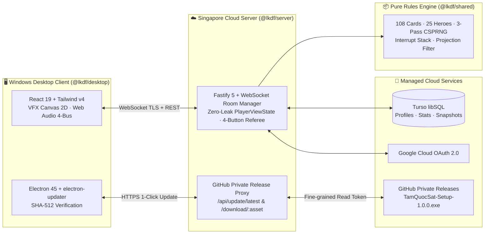

### 7.2. Chỉ số kiểm định chất lượng tự động (`Quality Gates`)

| Tầng kiểm định | Bộ công cụ | Phạm vi & Kết quả kiểm chứng |
| :--- | :--- | :--- |
| **Type Safety** | `TypeScript 5.8` (`--noEmit`) | **`0` lỗi** trên toàn bộ 3 workspace (`@lkdf/shared`, `@lkdf/server`, `@lkdf/desktop` renderer + main). |
| **Unit Testing** | `Vitest` (`packages/shared/tests/unit`) | **`101 / 101` bài test đạt 100%** (12 test files: 108 lá, 25 tướng, 40 kỹ năng, Vòng 1 Hòa Bình, chồng Phán xét, Vô Giải lồng nhau). |
| **Fuzz Simulation** | `Vitest` (`packages/shared/tests/fuzz`) | **`500 / 500` ván đấu tự động 4–8 người** (`6/6` suites, `< 50ms/ván`, **`0` deadlock**, **`0` rò rỉ `PlayerViewState`**). |
| **Server Integration** | `Vitest` (`apps/server/tests/integration`) | **`26 / 26` bài test đạt 100%** (7 test files: Google OAuth, SQLite/libSQL Snapshot khôi phục sau restart, Trọng Tài 4 nút, 30s failover, Update Proxy). |
| **Visual E2E Audit** | `Playwright / Live Browser` | **`0px` chồng lấn** ở cả `960×600` và `1280×720` (8 ghế + trang bị + phán xét), **`0` lỗi console**, **`0` lỗi HTTP**. |

<details>
<summary><b>📂 Bấm để mở: Mục lục 11 Tài liệu Đặc tả Dự án & Lệnh CLI dành cho Kỹ sư Phát triển</b></summary>

<br />

#### Hệ thống 11 tài liệu đặc tả trong kho mã nguồn
| STT | Tài liệu | Nội dung cốt lõi |
| :---: | :--- | :--- |
| **1** | **[README.md](./README.md)** | Trang chủ giới thiệu sản phẩm, cổng tải chính thức `v1.0.0` và cẩm nang toàn tập. |
| **2** | **[REQUIREMENTS.md](./REQUIREMENTS.md)** | Yêu cầu sản phẩm, bảng Thân Phận 4–8 người và 8 tiêu chí nghiệm thu (`AC-1`–`AC-8`). |
| **3** | **[RULES_STANDARD.md](./RULES_STANDARD.md)** | Đặc tả luật chuẩn Yoka 108 lá & 25 tướng dùng để đối chiếu mã nguồn. |
| **4** | **[DESIGN.md](./DESIGN.md)** | Hệ thống thiết kế Quốc Phong, bảng màu, tỷ lệ khung `960×600`–`2K`, VFX & Audio. |
| **5** | **[ARCHITECTURE.md](./ARCHITECTURE.md)** | Kiến trúc phân tầng Monorepo, bảo mật `PlayerViewState`, OAuth 2.0 & Update Proxy. |
| **6** | **[DATA_MODEL.md](./DATA_MODEL.md)** | Lược đồ cơ sở dữ liệu Turso/SQLite (`users`, `matches`, `room_snapshots`). |
| **7** | **[TESTING.md](./TESTING.md)** | Chiến lược kiểm thử 4 tầng (Unit, Fuzz 500 ván, Integration, Windows E2E). |
| **8** | **[DEPLOYMENT.md](./DEPLOYMENT.md)** | Quy trình vận hành Cloud (Turso, Render Singapore, Google Cloud, GitHub Releases). |
| **9** | **[HUONG_DAN_CHO_TOI.md](./HUONG_DAN_CHO_TOI.md)** | Sổ tay điều khiển dự án dành cho Chủ sản phẩm. |
| **10** | **[PROJECT_MEMORY.md](./PROJECT_MEMORY.md)** | Nhật ký kỹ thuật xuyên suốt dự án *(đồng bộ cùng [`.agents/PROJECT_MEMORY.md`](./.agents/PROJECT_MEMORY.md))*. |
| **11** | **[DECISIONS.md](./DECISIONS.md)** & **[AGENTS.md](./AGENTS.md)** | Hồ sơ 12 quyết định kiến trúc (`ADR-001`–`ADR-012`) và quy ước làm việc cho AI Agent. |

#### Lệnh làm việc cục bộ (Yêu cầu `Node.js >= 22`)
```powershell
# 1. Cài đặt toàn bộ dependencies
npm.cmd install

# 2. Kiểm tra kiểu dữ liệu & Build toàn bộ 3 workspace
npm.cmd run typecheck
npm.cmd run build

# 3. Chạy trọn bộ kiểm thử tự động (Unit + Fuzz 500 ván + Server Integration)
npm.cmd run test:unit
npm.cmd run test:fuzz
npm.cmd run test:integration

# 4. Đóng gói bộ cài đặt Windows NSIS (.exe + latest.yml) tại apps/desktop/release/
npm.cmd run package:win
```

</details>

---

<div align="center">
  <b>殺 TAM QUỐC SÁT — XÍCH BÍCH ĐẠI CHIẾN (v1.0.0)</b><br/>
  <sub>Thiết kế & Phát triển cho trải nghiệm chiến thuật bàn tròn 4–8 người chơi trên Windows 10/11</sub>
</div>
